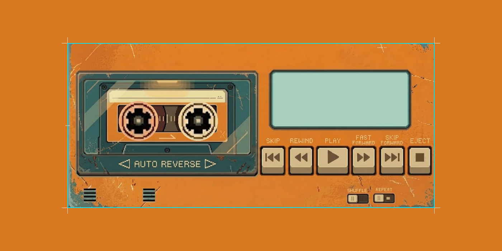

# 📼 Sunset Cassette

<p align="center">
  
</p>

<p align="center">
  <strong>A chunky 16-bit vintage cassette Walkman music player for Android.</strong><br>
  Blends local audio files with Spotify playlists into tactile physical cassettes stored on wooden shelves and cardboard shoe boxes.
</p>

<p align="center">
  <a href="https://github.com/FlamingoTwist/Sunset-Pixels/releases/latest"></a>
  <a href="https://github.com/FlamingoTwist/Sunset-Pixels/raw/main/Sunset-Cassette.apk"></a>
  
  
  
  
</p>

---

## 📥 Download & Install

Get the latest stable build directly:

- 📦 **[Download Sunset-Cassette.apk (Direct Repo Link)](https://github.com/FlamingoTwist/Sunset-Pixels/raw/main/Sunset-Cassette.apk)**
- 🏷️ **[Latest Release Notes (v0.4.0)](https://github.com/FlamingoTwist/Sunset-Pixels/releases/latest)**

> **Note**: To install on your device, enable *"Install unknown apps"* for your browser or file manager when prompted.

---

## ✨ Features

### 📻 The 16-Bit Walkman Deck
- **Retro Distressed Chassis**: Warm mustard/amber yellow-orange vintage enclosure with pixel-perfect speaker grilles and beveled bays.
- **Physical Cassette Bay**: Clear tape window with warm deck lamp, stationary inner chassis, and realistic cassette drop-in / eject animations.
- **Dynamic Spinning Reels**: Stepped mechanical reel spokes with magnetic tape pack radii that dynamically grow and shrink in real time as the tape plays from spool to spool.
- **Mint-Green Dot-Matrix LCD**: Backlit pixel display with smooth scrolling track title, artist, audio source badge, elapsed/total time codes, and transport status indicators (`PLAY`, `PAUSE`, `STOP`, `FWD`, `REW`).
- **Dual-Orientation Support**: Bespoke retro layouts designed natively for both **Portrait** (one-handed Walkman) and **Landscape** (desktop boombox deck).

### 🎨 Authentic Cassette Collection
- **5 Vintage Shell Colorways**: Cassettes roll in authentic retro varieties—*Cream Beige*, *Studio Obsidian Charcoal*, *Sports Yellow*, *Miami Mint*, and *Synthwave Crimson*—with classic textured off-white labels.
- **Crunchy 16-Bit Artwork**: High-resolution album and playlist cover art is converted on-the-fly into 48×48 palette-quantized pixel art with crisp nearest-neighbor filtering (`FilterQuality.None`).
- **Artist Shelf 📚**: Browse your local music library organized as physical cassettes on a wooden shelf, complete with expandable multi-album box sets.
- **Playlist Shoe Box 📦**: Flip through homemade mixtapes and imported Spotify playlists tucked into a nostalgic cardboard shoe box with handwritten-style labels.

### 🛒 Sunset Record Shop ("The Shop")
- Dig through crates of your local music collection by **Artists**, **Albums**, and **Songs**.
- Instant, CRT-styled real-time search across your entire collection.
- One-tap `▶ PLAY` to instantly cue up tracks or `🔴 REC` to press songs directly onto your custom mixtapes.
- 100% offline crate-digging with zero network delays.

### 🖲️ Tactile Mechanical Controls
- **Chunky Transport Buttons**: Skip Previous, Rewind, Play, Fast-Forward, Skip Next, and Stop/Eject with authentic mechanical audio samples and physical haptic feedback.
- **Authentic Dual-Purpose Stop/Eject**: Operates just like a real vintage Walkman—pressing Stop halts playback, and pressing it again when stopped mechanically ejects the cassette.
- **Smooth Scrubbing**: Tap to seek `±10s`, or press-and-hold for continuous `±5s` mechanical repeat scrubbing.
- **Physical Rocker Switches**: Dedicated mechanical switches for **Shuffle** and **Repeat**.

### 🎧 Authentic Spotify App Remote + Local Audio
- **Local First**: Native high-fidelity offline audio powered by AndroidX Media3 (`ExoPlayer`).
- **Genuine Spotify App Remote Playback**: Seamlessly links to the official Spotify app headlessly via IPC (`SpotifyAppRemote`). Streams authentic full-length tracks with zero 30-second previews and zero unofficial scrapers.
- **Anti-Pocket Playback Protection**: Connection and state sync remain strictly read-only; the app will never fire unsolicited play broadcasts upon resume or screen wake.
- **Instant Shelf Cache**: Serialized library cache (`spotify_library_cache_v2.json`) ensures your shelves and last inserted cassette appear instantly on frame 1 upon app launch.

### 🚗 Android Auto / Automotive Support
- Certified Android Auto media service (`androidx.media3.session.MediaLibraryService`).
- Browse your Artist Shelf and Shoe Box playlists straight from your car's touchscreen console for distraction-free in-car listening.

---

## 🛠️ Architecture & Tech Stack

| Layer | Technology |
|---|---|
| **Language** | Kotlin 2.0 |
| **UI Framework** | Jetpack Compose + Compose BOM |
| **Visual Layout Pipeline** | Android Studio Native XML Layout Editor (`activity_deck.xml`) |
| **Audio Engine** | AndroidX Media3 (`ExoPlayer`) 1.4+ |
| **Spotify SDK** | Spotify App Remote SDK + OAuth 2.0 PKCE |
| **Automotive** | Android Auto (`MediaLibraryService` & `MediaBrowserService`) |
| **Art & Assets** | Aseprite, 16-bit custom sprite slices, nearest-neighbor bitmap scaling |

---

## 🏗️ Building from Source

### Prerequisites
- **JDK**: JetBrains Runtime 21 or OpenJDK 21
- **Android SDK**: Compile SDK 35, Min SDK 26

### Build via Gradle
```bash
# Set Java 21 environment if needed
export JAVA_HOME="/path/to/jdk-21"

# Assemble debug APK
./gradlew assembleDebug
```

On Windows (PowerShell):
```powershell
$env:JAVA_HOME = "C:\Users\neila\.jdks\jbr-21.0.11"
& "C:\Users\neila\.gradle\wrapper\dists\gradle-8.9-bin\90cnw93cvbtalezasaz0blq0a\gradle-8.9\bin\gradle.bat" assembleDebug
```

The resulting package will be generated at `app/build/outputs/apk/debug/app-debug.apk`.

---

## 📜 License

Created with ❤️ by **Neil Amos** ([FlamingoTwist](https://github.com/FlamingoTwist)).
All pixel artwork and design assets are handcrafted for the Sunset Cassette project.
